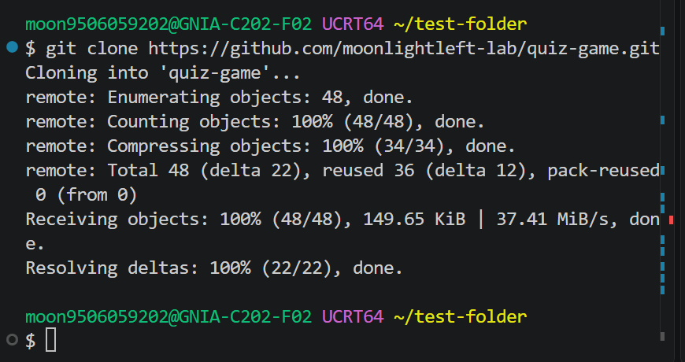
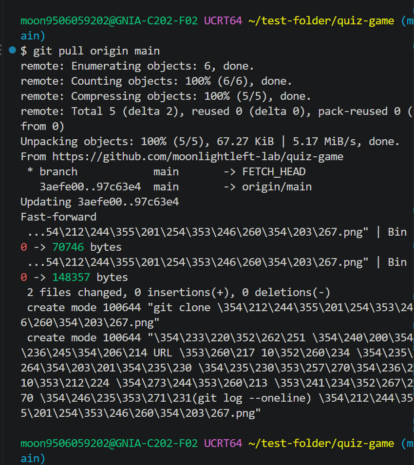

# Quiz Game
Python으로 만든 콘솔 기반 퀴즈 게임입니다.
## 주요 기능
- 기본 퀴즈 제공
- 메뉴 선택 기능
- 퀴즈 풀기
- 퀴즈 목록 확인
- 퀴즈 데이터 저장 및 불러오기
- `state.json` 파일을 이용한 상태 저장
## 실행 방
터미널에서 아래 명령어를 실행합니다.
```bash
python main.py
```
## Git clone 실습
- 별도 폴더에서 git clone을 수행했습니다.
- clone 저장소에서 README를 수정하고 push했습니다.
## clone/pull 실행 증빙
- 별도 폴더에서 `git clone`을 수행했습니다.
- 원격 저장소의 변경 사항을 `git pull origin main`으로 가져왔습니다.
- 아래는 clone/pull 실행 터미널 스크린샷입니다.
## git clone 실행 스크린샷

## git pull 실행 스크린샷



# Quiz와 Game의 책임분리
## 1. Quiz 클래스 (데이터 모델)
- 역할: 질문, 보기, 정답 데이터를 저장하는 클래스
- 책임: 퀴즈 데이터 관리
## 2. Game 클래스 (로직 컨트롤러)
- 역할: 퀴즈 게임의 진행 흐름을 관리하는 클래스
- 책임: 사용자로부터 입력을 받는 기능, 정답 판정하는 로직, 계산 및 결과 출력 등 게임의 '동작'을 담당

> 분리 이유: 퀴즈의 내용(Data)이 바뀌더라도 게임의 규칙(Logic)은 변하지 않으며, 반대로 게임 규칙이 바뀌어도 퀴즈 데이터는 그대로 재사용할 수 있도록 클래스 간의 역할(책임)을 명확히 분리


# 입력검증·게임진행·데이터입출력 로직 분리
이 프로젝트에서는 기능을 한 곳에 모두 작성하지 않고, 역할에 따라 로직을 분리했습니다.
## 1. 입력 검증 로직
- 사용자 입력이 올바른 형식인지 확인하는 역할입니다.
- 예를 들어 메뉴 번호, 정답 입력, 빈 입력 등을 확인합니다.
- 입력 검증을 분리한 이유는 잘못된 입력이 게임 진행 로직에 직접 영향을 주지 않도록 하기 위해서입니다.
## 2. 게임 진행 로직
- 퀴즈를 보여주고, 사용자의 답을 받아 정답 여부를 판단하는 역할입니다.
- 점수 계산, 다음 문제 진행, 게임 종료 흐름을 관리합니다.
- 게임 진행 로직을 분리한 이유는 프로그램의 핵심 흐름을 명확하게 관리하기 위해서입니다.
## 3. 데이터 입출력 로직
- 퀴즈 데이터나 게임 상태를 파일에서 불러오고 저장하는 역할입니다.
- `state.json` 파일을 이용해 데이터를 저장하거나 불러옵니다.
- 데이터 입출력 로직을 분리한 이유는 파일 저장 방식이 바뀌어도 게임 진행 로직을 크게 수정하지 않기 위해서입니다.

> 로직 분리 이유 요약
- 입력 검증, 게임 진행, 데이터 입출력은 서로 책임이 다릅니다.
- 각 로직을 분리하면 코드의 역할이 명확해집니다.
- 문제가 발생했을 때 어느 부분을 수정해야 하는지 찾기 쉽습니다.
- 이후 기능을 추가하거나 수정할 때 유지보수가 쉬워집니다.


# 커밋 규칙 (Commit Convention)
## 1. 커밋 메시지 템플릿
커밋 메시지는 아래와 같은 형식을 권장합니다.
> **`<type>: <subject>`**(작업의 종류: 작업의 내용) *예시: `feat: 퀴즈 점수 계산 기능 추가`*
- **feat**: 새로운 기능 추가
- **fix**: 버그 수정
- **docs**: 문서 수정 (README.md 등)
- **style**: 코드 포맷팅, 세미콜론 누락 등 (코드 변경 없는 경우)
- **refactor**: 코드 리팩토링
- **test**: 테스트 코드 추가
- **chore**: 빌드 업무 수정, 패키지 매니저 설정 등
## 2. 커밋 단위 (Commit Unit)
- **기능 단위**: 하나의 커밋은 하나의 논리적인 기능 변화만 담습니다.(여러 작업을 한꺼번에 뭉펴서 커밋X)
- **작동 가능**: 커밋된 시점의 코드는 항상 오류 없이 실행 가능해야 합니다.(코드를 반만짜고 퇴근한다고 커밋하면 안됨)
- **의미 있는 단위**: "오타 수정"과 "UI 레이아웃 수정"은 가급적 분리하여 커밋합니다.(main.py과 README.md에 수정을 같이 섞지X)


# 클래스 설계 근거 (Design Rationale)
본 프로젝트는 객체 지향 프로그래밍(OOP)의 핵심 원칙을 적용하여 `Quiz`와 `QuizGame` 클래스로 설계되었습니다.
## 1. Quiz 클래스: 데이터의 추상화 (Abstraction)
- **이유**: 퀴즈 한 문항이 가지는 공통 속성(질문, 보기, 정답)을 하나의 단위로 묶기 위함입니다.
- **효과**: 복잡한 데이터를 직접 다루지 않고, `Quiz` 객체라는 추상화된 개념을 통해 퀴즈 데이터를 쉽고 안전하게 관리할 수 있습니다.
## 2. QuizGame 클래스: 로직의 캡슐화 및 재사용성 (Reusability)
- **이유**: 점수 계산, 게임 진행 상태 관리 등 게임의 핵심 로직을 데이터와 분리하여 관리하기 위함입니다.
- **효과**: 
  - **재사용성**: 동일한 게임 로직을 유지하면서 다양한 퀴즈 리스트만 교체하여 새로운 게임을 쉽게 만들 수 있습니다.
  - **유지보수**: 게임 진행 방식(로직)을 수정할 때 `Quiz` 데이터를 건드리지 않고 `QuizGame` 클래스만 수정하면 되므로 관리가 용이합니다.


# 데이터 저장 및 관리
본 프로젝트는 퀴즈 진행 상태를 유지하기 위해 `state.json`(프로그램의 저장 데이터가 담긴 메모장) 파일을 사용하여 데이터를 저장합니다.
-왜 state.json을 쓰는지? 만약 이 파일 이 없다면, 프로그램을 끄는 순간 모든 데이터가 컴퓨터 메모리에서 사라짐. 즉 아까점수를 기억하고 파일만 복사해서 다른 컴퓨터에 옮기면 다른 곳에서도 내 점수 그대로 이어서 할 수 있음.
## JSON 포맷 선택 근거
단순 텍스트 파일 대신 JSON 형식을 채택한 이유는 다음과 같습니다.
1. **가독성 (Readability)**:
   - 데이터가 텍스트 기반으로 저장되어 개발자가 직접 파일을 열어 상태를 쉽게 확인하고 수정할 수 있어 디버깅에 유리합니다.
2. **구조화 (Structured Data)**:
   - 키-값(Key-Value) 쌍의 계층적 구조를 가질 수 있어, 사용자 정보, 점수, 진행 단계 등 복잡한 데이터를 체계적으로 관리하기에 적합합니다.
   - 파이썬의 딕셔너리(Dictionary키:값) 자료형과 직관적으로 매핑되어 코드 구현이 효율적입니다.


# 대량 데이터 처리 및 최적화 전략 (1,000개 이상의 퀴즈 데이터)
데이터 규모가 커질 경우(1,000개~10,000개 이상) 발생할 수 있는 성능 저하를 방지하기 위해 다음과 같은 전략을 채택합니다.
## 1. 자료구조 최적화 (Search Speed)
문제점: 리스트(List) 구조에서 특정 ID의 퀴즈를 찾으려면 처음부터 끝까지 훑어야 하므로 시간이 오래 걸립니다 ($O(n)$).
**$n$**은 데이터의 개수를 뜻합니다.
**$O(n)$**은 "데이터가 많아질수록 나도 그만큼 느려져요"라는 뜻이고,
**$O(1)$**은 "데이터가 아무리 많아도 난 항상 똑같이 빨라요"라는 뜻입니다.해결책: 퀴즈 데이터를 로드할 때 해시 맵(Dictionary/Map) 자료구조를 사용하여 ID를 Key로 저장합니다. 이를 통해 데이터 양에 상관없이 즉각적으로 특정 퀴즈를 조회할 수 있습니다 ($O(1)$).
## 2. 인덱싱 전략 (Filtering Speed)
문제점: '과학' 카테고리나 '난이도 상'인 문제만 뽑아낼 때 매번 전체 데이터를 전수 조사해야 합니다.
해결책: 카테고리별, 난이도별로 별도의 인덱스(Index) 리스트를 메모리에 유지합니다.
예: {"Science": [id1, id5, id10], "History": [id2, id3]}
사용자가 카테고리를 선택하면 전체를 뒤지지 않고 해당 인덱스에 포함된 ID만 즉시 가져옵니다.
## 3. 메모리 관리 및 지연 로딩 (Memory Usage)
문제점: 수만 개의 데이터를 한꺼번에 메모리에 올리면 프로그램 점유율이 높아집니다.
해결책:
Lazy Loading (지연 로딩): 처음에는 퀴즈의 ID와 제목만 로드하고, 실제 문제가 출제되는 시점에 상세 내용(지문, 보기)을 읽어옵니다.
Pagination (페이지네이션): 관리자 화면 등에서 목록을 보여줄 때 한 번에 20~50개씩 끊어서 로드하여 메모리 부하를 줄입니다.
## 4. 확장 계획 (Scalability)
데이터가 10만 건 이상으로 늘어날 경우, 단순 JSON 파일 대신 SQLite와 같은 경량 데이터베이스를 도입하여 디스크 기반 인덱싱과 쿼리 최적화를 수행할 예정입니다.


# 대량 데이터 처리 최적화 전략
현재 `state.json`을 활용한 파일 저장 방식에서 데이터가 수만 건 이상으로 늘어날 경우를 대비한 최적화 전략입니다.
## 1. 현재 방식(JSON)의 한계
- **메모리 부하:** 데이터를 읽을 때 파일 전체를 메모리에 올려야 하므로, 데이터가 커질수록 RAM 사용량이 급증합니다.
- **쓰기 성능 저하:** 단 하나의 데이터만 수정해도 파일 전체를 다시 써야 하므로 디스크 I/O 병목 현상이 발생합니다.
## 2. 최적화 및 확장 전략
- **데이터베이스(SQLite) 도입:** 
  - JSON 대신 관계형 DB를 사용하여 필요한 데이터만 `SELECT`하여 가져옵니다.
  - 인덱스(Index)를 설정하여 수만 개의 퀴즈 중 특정 조건의 데이터를 빠르게 검색합니다.
- **지연 로딩(Lazy Loading):**
  - 처음부터 모든 퀴즈를 로드하지 않고, 사용자가 문제를 풀 때마다 일정량(예: 10개 단위)씩 나누어 불러옵니다.
- **캐싱(Caching) 메커니즘:**
  - 자주 조회되는 랭킹 데이터나 설정값은 메모리에 캐싱하여 디스크 접근 횟수를 최소화합니다.
- **비동기 저장(Asynchronous I/O):**
  - 게임 진행에 방해가 되지 않도록 저장 로직을 별도 스레드에서 비동기적으로 처리합니다.


# GitHub 저장소 및 커밋 증빙
## 원격 저장소 주소
본 프로젝트는 GitHub 원격 저장소와 연결하여 clone, commit, push 실습을 수행했습니다.
- 원격 저장소: https://github.com/moonlightleft-lab/quiz-game
## 원격 저장소 확인 명령어
```bash
git remote -v
```
실행 결과:
```bash
origin  https://github.com/moonlightleft-lab/quiz-game.git (fetch)
origin  https://github.com/moonlightleft-lab/quiz-game.git (push)
```
## 커밋 수 확인
```bash
git rev-list --count HEAD
```
실행 결과:
```bash
29
```
전체 커밋 수가 10개 이상임을 확인했습니다.
## git log 증빙
```bash
git log --oneline -10
```
실행 결과:
```bash
3da59cd (HEAD -> main, origin/main) 전체코드수정
60fd45a (origin/practice, practice) Docs: 대량 데이터 최적화 전략 내용 추가
1bd59c0 Feat: JSON 저장 및 백업 복구 기능 구현
d5e8f2f 대량 데이터 처리 및 최적화 전략
111c92d docs: state.json 사용 명시 및 JSON채택 근거 추가
a92a128 docs: 클래스 설계 근거 추가
0f7c7d1 평가 핸들링 추가 및 README수정
d39759b Merge branch 'main' of https://github.com/moonlightleft-lab/quiz-game
ed508ee Delete unnecessary screenshot
ffd25cd Add files via upload
```
## GitHub 커밋 화면
GitHub 저장소의 Commits 화면에서도 커밋 이력을 확인할 수 있습니다.
- 커밋 내역 화면: https://github.com/moonlightleft-lab/quiz-game/commits/main


@"
# 브랜치 및 병합 기록 증빙
본 파일은 평가 항목 #6의 브랜치 생성 및 병합 기록을 증빙하기 위해 작성했습니다.
- 작업 브랜치: evidence-merge
- 병합 대상 브랜치: main
- 병합 방식: --no-ff 옵션을 사용한 merge commit 생성
- 확인 명령어: git log --graph --oneline --decorate --all -20
"@ | Set-Content -Encoding UTF8 MERGE_EVIDENCE.md